### Projects

<!-- main:start -->
<a href="https://github.com/SMSpp-Project/smspp-project"><picture><source media="(prefers-color-scheme: dark)" srcset="assets/cards/SMSpp-Project-smspp-project-dark.svg"></picture></a>
 
<a href="https://github.com/aimacode/aima-python"><picture><source media="(prefers-color-scheme: dark)" srcset="assets/cards/aimacode-aima-python-dark.svg"></picture></a>
 
<a href="https://github.com/dmeoli/NeuroSAT"><picture><source media="(prefers-color-scheme: dark)" srcset="assets/cards/NeuroSAT-dark.svg"></picture></a>
 
<a href="https://github.com/dmeoli/SicilianNMT"><picture><source media="(prefers-color-scheme: dark)" srcset="assets/cards/SicilianNMT-dark.svg"></picture></a>
 
<a href="https://github.com/dmeoli/lemon-ng"><picture><source media="(prefers-color-scheme: dark)" srcset="assets/cards/lemon-ng-dark.svg"></picture></a>
 
<a href="https://github.com/dmeoli/ADS"><picture><source media="(prefers-color-scheme: dark)" srcset="assets/cards/ADS-dark.svg"></picture></a>
 
<a href="https://github.com/dmeoli/PBeFS"><picture><source media="(prefers-color-scheme: dark)" srcset="assets/cards/PBeFS-dark.svg"></picture></a>
 
<a href="https://github.com/dmeoli/optiml"><picture><source media="(prefers-color-scheme: dark)" srcset="assets/cards/optiml-dark.svg"></picture></a>
<!-- main:end -->

### Tools

<!-- tools:start -->
<a href="https://github.com/dmeoli/code-style"><picture><source media="(prefers-color-scheme: dark)" srcset="assets/cards/code-style-dark.svg"></picture></a>
<a href="https://github.com/dmeoli/lamalunga"><picture><source media="(prefers-color-scheme: dark)" srcset="assets/cards/lamalunga-dark.svg"></picture></a>
<a href="https://github.com/dmeoli/PESAD"><picture><source media="(prefers-color-scheme: dark)" srcset="assets/cards/PESAD-dark.svg"></picture></a>
<a href="https://github.com/dmeoli/FuzzyCLIPS"><picture><source media="(prefers-color-scheme: dark)" srcset="assets/cards/FuzzyCLIPS-dark.svg"></picture></a>
<a href="https://github.com/dmeoli/WNAffect"><picture><source media="(prefers-color-scheme: dark)" srcset="assets/cards/WNAffect-dark.svg"></picture></a>
<!-- tools:end -->

### Gists

<!-- gists:start -->
<a href="https://gist.github.com/dmeoli/fa340ecc4dd7435542b858b93b514f2c"><picture><source media="(prefers-color-scheme: dark)" srcset="assets/gists/fa340ecc4dd7435542b858b93b514f2c-dark.svg"></picture></a>
<a href="https://gist.github.com/dmeoli/b4910d66920609e3bad334194f6317ab"><picture><source media="(prefers-color-scheme: dark)" srcset="assets/gists/b4910d66920609e3bad334194f6317ab-dark.svg"></picture></a>
<a href="https://gist.github.com/dmeoli/69b02099accc84dda40b48fb69cd51c9"><picture><source media="(prefers-color-scheme: dark)" srcset="assets/gists/69b02099accc84dda40b48fb69cd51c9-dark.svg"></picture></a>
<a href="https://gist.github.com/dmeoli/0cd91d3ed8ea8e568ccfc5200de99fd0"><picture><source media="(prefers-color-scheme: dark)" srcset="assets/gists/0cd91d3ed8ea8e568ccfc5200de99fd0-dark.svg"></picture></a>
<!-- gists:end -->

### Languages

<picture>
  <source media="(prefers-color-scheme: dark)" srcset="assets/languages-dark.svg">
  
</picture>

<picture>
  <source media="(prefers-color-scheme: dark)" srcset="https://raw.githubusercontent.com/dmeoli/dmeoli/output/snake-dark.svg">
  
</picture>
