<!-- software:start -->
### 🔬 Projects

<a href="https://github.com/SMSpp-Project/smspp-project"><picture><source media="(prefers-color-scheme: dark)" srcset="assets/cards/SMSpp-Project-smspp-project-dark.svg"><source media="(prefers-color-scheme: light)" srcset="assets/cards/SMSpp-Project-smspp-project-light.svg"></picture></a>
<a href="https://github.com/aimacode/aima-python"><picture><source media="(prefers-color-scheme: dark)" srcset="assets/cards/aimacode-aima-python-dark.svg"><source media="(prefers-color-scheme: light)" srcset="assets/cards/aimacode-aima-python-light.svg"></picture></a>
<a href="https://github.com/dmeoli/NeuroSAT"><picture><source media="(prefers-color-scheme: dark)" srcset="assets/cards/NeuroSAT-dark.svg"><source media="(prefers-color-scheme: light)" srcset="assets/cards/NeuroSAT-light.svg"></picture></a>
<a href="https://github.com/dmeoli/GQSAT"><picture><source media="(prefers-color-scheme: dark)" srcset="assets/cards/GQSAT-dark.svg"><source media="(prefers-color-scheme: light)" srcset="assets/cards/GQSAT-light.svg"></picture></a>
<a href="https://github.com/dmeoli/SicilianNMT"><picture><source media="(prefers-color-scheme: dark)" srcset="assets/cards/SicilianNMT-dark.svg"><source media="(prefers-color-scheme: light)" srcset="assets/cards/SicilianNMT-light.svg"></picture></a>
<a href="https://github.com/dmeoli/abLEMON"><picture><source media="(prefers-color-scheme: dark)" srcset="assets/cards/abLEMON-dark.svg"><source media="(prefers-color-scheme: light)" srcset="assets/cards/abLEMON-light.svg"></picture></a>
<a href="https://github.com/dmeoli/ADS"><picture><source media="(prefers-color-scheme: dark)" srcset="assets/cards/ADS-dark.svg"><source media="(prefers-color-scheme: light)" srcset="assets/cards/ADS-light.svg"></picture></a>
<a href="https://github.com/dmeoli/PBeFS"><picture><source media="(prefers-color-scheme: dark)" srcset="assets/cards/PBeFS-dark.svg"><source media="(prefers-color-scheme: light)" srcset="assets/cards/PBeFS-light.svg"></picture></a>
<a href="https://github.com/dmeoli/optiml"><picture><source media="(prefers-color-scheme: dark)" srcset="assets/cards/optiml-dark.svg"><source media="(prefers-color-scheme: light)" srcset="assets/cards/optiml-light.svg"></picture></a>
<a href="https://github.com/SPSUnipi/pySMSpp"><picture><source media="(prefers-color-scheme: dark)" srcset="assets/cards/SPSUnipi-pySMSpp-dark.svg"><source media="(prefers-color-scheme: light)" srcset="assets/cards/SPSUnipi-pySMSpp-light.svg"></picture></a>
<a href="https://github.com/SPSUnipi/pypsa2smspp"><picture><source media="(prefers-color-scheme: dark)" srcset="assets/cards/SPSUnipi-pypsa2smspp-dark.svg"><source media="(prefers-color-scheme: light)" srcset="assets/cards/SPSUnipi-pypsa2smspp-light.svg"></picture></a>
<a href="https://github.com/qpsolvers/qpsolvers"><picture><source media="(prefers-color-scheme: dark)" srcset="assets/cards/qpsolvers-qpsolvers-dark.svg"><source media="(prefers-color-scheme: light)" srcset="assets/cards/qpsolvers-qpsolvers-light.svg"></picture></a>

### 🗃️ Earlier projects

<a href="https://github.com/dmeoli/WS4J"><picture><source media="(prefers-color-scheme: dark)" srcset="assets/cards/WS4J-dark.svg"><source media="(prefers-color-scheme: light)" srcset="assets/cards/WS4J-light.svg"></picture></a>
<a href="https://github.com/dmeoli/BeerEX"><picture><source media="(prefers-color-scheme: dark)" srcset="assets/cards/BeerEX-dark.svg"><source media="(prefers-color-scheme: light)" srcset="assets/cards/BeerEX-light.svg"></picture></a>
<a href="https://github.com/dmeoli/PESAD"><picture><source media="(prefers-color-scheme: dark)" srcset="assets/cards/PESAD-dark.svg"><source media="(prefers-color-scheme: light)" srcset="assets/cards/PESAD-light.svg"></picture></a>
<a href="https://github.com/dmeoli/WNAffect"><picture><source media="(prefers-color-scheme: dark)" srcset="assets/cards/WNAffect-dark.svg"><source media="(prefers-color-scheme: light)" srcset="assets/cards/WNAffect-light.svg"></picture></a>
<a href="https://github.com/dmeoli/FuzzyCLIPS"><picture><source media="(prefers-color-scheme: dark)" srcset="assets/cards/FuzzyCLIPS-dark.svg"><source media="(prefers-color-scheme: light)" srcset="assets/cards/FuzzyCLIPS-light.svg"></picture></a>
<a href="https://github.com/dmeoli/OnlineRetail"><picture><source media="(prefers-color-scheme: dark)" srcset="assets/cards/OnlineRetail-dark.svg"><source media="(prefers-color-scheme: light)" srcset="assets/cards/OnlineRetail-light.svg"></picture></a>

### 🛠️ Tools

<a href="https://github.com/dmeoli/code-style"><picture><source media="(prefers-color-scheme: dark)" srcset="assets/cards/code-style-dark.svg"><source media="(prefers-color-scheme: light)" srcset="assets/cards/code-style-light.svg"></picture></a>
<a href="https://github.com/dmeoli/lamalunga"><picture><source media="(prefers-color-scheme: dark)" srcset="assets/cards/lamalunga-dark.svg"><source media="(prefers-color-scheme: light)" srcset="assets/cards/lamalunga-light.svg"></picture></a>
<!-- software:end -->

### 📝 Gists

<!-- gists:start -->
<a href="https://gist.github.com/dmeoli/789fa67105c236f4fd04bcb000c01b02"><picture><source media="(prefers-color-scheme: dark)" srcset="assets/gists/789fa67105c236f4fd04bcb000c01b02-dark.svg"><source media="(prefers-color-scheme: light)" srcset="assets/gists/789fa67105c236f4fd04bcb000c01b02-light.svg"></picture></a>
<a href="https://gist.github.com/dmeoli/fa340ecc4dd7435542b858b93b514f2c"><picture><source media="(prefers-color-scheme: dark)" srcset="assets/gists/fa340ecc4dd7435542b858b93b514f2c-dark.svg"><source media="(prefers-color-scheme: light)" srcset="assets/gists/fa340ecc4dd7435542b858b93b514f2c-light.svg"></picture></a>
<a href="https://gist.github.com/dmeoli/b4910d66920609e3bad334194f6317ab"><picture><source media="(prefers-color-scheme: dark)" srcset="assets/gists/b4910d66920609e3bad334194f6317ab-dark.svg"><source media="(prefers-color-scheme: light)" srcset="assets/gists/b4910d66920609e3bad334194f6317ab-light.svg"></picture></a>
<a href="https://gist.github.com/dmeoli/69b02099accc84dda40b48fb69cd51c9"><picture><source media="(prefers-color-scheme: dark)" srcset="assets/gists/69b02099accc84dda40b48fb69cd51c9-dark.svg"><source media="(prefers-color-scheme: light)" srcset="assets/gists/69b02099accc84dda40b48fb69cd51c9-light.svg"></picture></a>
<a href="https://gist.github.com/dmeoli/0cd91d3ed8ea8e568ccfc5200de99fd0"><picture><source media="(prefers-color-scheme: dark)" srcset="assets/gists/0cd91d3ed8ea8e568ccfc5200de99fd0-dark.svg"><source media="(prefers-color-scheme: light)" srcset="assets/gists/0cd91d3ed8ea8e568ccfc5200de99fd0-light.svg"></picture></a>
<!-- gists:end -->

### 📊 Languages

<picture>
  <source media="(prefers-color-scheme: dark)" srcset="assets/languages-dark.svg">
  <source media="(prefers-color-scheme: light)" srcset="assets/languages-light.svg">
  
</picture>

<picture>
  <source media="(prefers-color-scheme: dark)" srcset="https://raw.githubusercontent.com/dmeoli/dmeoli/output/snake-dark.svg">
  <source media="(prefers-color-scheme: light)" srcset="https://raw.githubusercontent.com/dmeoli/dmeoli/output/snake-light.svg">
  
</picture>
