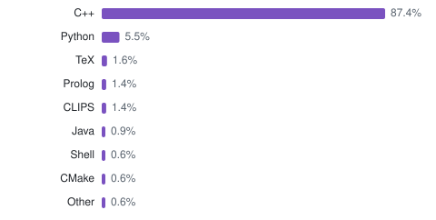

### Software

- [NeuroSAT](https://github.com/dmeoli/NeuroSAT), neuro-symbolic approaches to the SAT problem
- [PESAD](https://github.com/dmeoli/PESAD), an expert system in Prolog for anxiety, obsessive-compulsive and trauma-related disorders
- [WNAffect](https://github.com/dmeoli/WNAffect), the emotion of a word from WordNet Affect
- [FuzzyCLIPS](https://github.com/dmeoli/FuzzyCLIPS), fuzzy logic for CLIPS, written in pure CLIPS
- [SicilianNMT](https://github.com/dmeoli/SicilianNMT), neural machine translation between Sicilian, English and Italian
- [lamalunga](https://github.com/dmeoli/lamalunga), a beamer theme and LaTeX library of golden proportions and colors computed from one primary
- [code-style](https://github.com/dmeoli/code-style), a formatter for C++ and a check of pull requests that suggests the fixes on their lines
- [lemon-ng](https://github.com/dmeoli/lemon-ng), a maintained fork of LEMON, the C++ library of graph and network optimization
- [ADS](https://github.com/dmeoli/ADS), a header-only C++20 library of algorithms and data structures
- [PBeFS](https://github.com/dmeoli/PBeFS), parallel best-first search in C++20

### Gists

<!-- gists:start -->
- [sun-brightness](https://gist.github.com/dmeoli/fa340ecc4dd7435542b858b93b514f2c): screen brightness (DDC/CI monitors and laptop panel) and Night Light warmth that follow sunset and sunrise, with gradual ramps
- [gmailify](https://gist.github.com/dmeoli/b4910d66920609e3bad334194f6317ab): Gmailify again. Two-way sync between Gmail and the mailboxes forwarded to it (Outlook.com / Microsoft 365 via OAuth, or any IMAP server): inbox/archive/trash/spam, read, star/flag, every 2 minutes
- [gdrive-bisync](https://gist.github.com/dmeoli/69b02099accc84dda40b48fb69cd51c9): two-way Google Drive sync on Linux with rclone bisync and a systemd timer, with guards against mass deletions and conflicts kept side by side
- [vpn](https://gist.github.com/dmeoli/0cd91d3ed8ea8e568ccfc5200de99fd0): keep a SonicWall Connect Tunnel (Aventail, startct) VPN up on Linux, headless under systemd: detects frozen tunnels, expired sessions, suspend, and the server holding sessions after logout
<!-- gists:end -->

### Languages

<picture>
  <source media="(prefers-color-scheme: dark)" srcset="assets/languages-dark.svg">
  
</picture>

<picture>
  <source media="(prefers-color-scheme: dark)" srcset="https://raw.githubusercontent.com/dmeoli/dmeoli/output/snake-dark.svg">
  
</picture>
